# 《如果那年》内核架构方案 v3（草案）

> 一句话：**先有一个会自己往前走的小世界，事件只是这个世界每年冒出来的动静。**
> 现内核是「一副牌 + 一堆旗子」：每年抽一张事件，数值动一动，重要的事立旗子。新内核换成三层——世界层（人和事各自的进程）、过程层（不用抽、算出来的账）、叙事层（动静冒出来才讲）。判词、影子、复盘、结算都只是对同一本人生账本的不同看法。
>
> 本稿为方向稿，供用户审定。图共 11 张：总架构 1、年度循环 1、状态迁移 7、数据结构 1、迁移路线 1。

---

## 一、现内核为什么显得「流于表面」

1. **世界没有记忆，只有旗子。** 事件不改变世界，只改数值和立旗。30 岁的事想接上 28 岁的事，只能靠人工编旗子链——内容永远在追赶连贯性。
2. **抽牌是失忆的。** 每年独立采样。真实人生有惯性：贷款在摊还、孩子在长大、父母在变老、手艺在涨或锈。这些「一直在走的进程」现在全靠事件链假装。
3. **分岔是预约制的。** 固定年龄触发。处境和偶然没有家——它们不是「抽到一张牌」，而是先改变了这个人的状态，往后几十年的牌池都跟着变。
4. **路线是一块牌子。** route 只有一个枚举值，装不下「大厂里的人回乡种地」「出国的人后来流浪」这种真实的复合状态。
5. **时间是均匀的。** 每年必抽一件事，温度、平淡年只能当外挂旋钮补上，本质上是模型里没有「无事发生」的位置。

---

## 二、目标架构：三层 + 一本账 + 一组视图

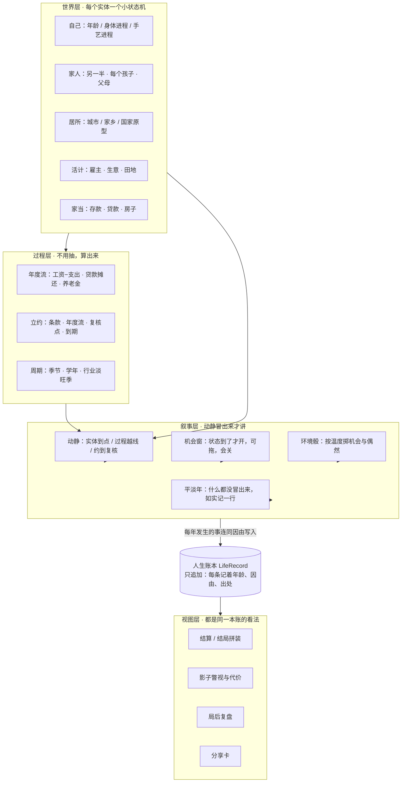

要点：

- **叙事层不再生产事实，只呈现事实。** 一件事能不能讲，先看世界层和过程层有没有把它生出来。事实过滤从「写完判词再逐句核对」变成结构上不可能说错——账本里没有的，视图层拿不到。
- **内容（现有 2000+ 条事件）不作废**，降为环境骰的牌池与动静的文案皮，继续供血，迁移期游戏不会被掏空。

---

## 三、世界层：实体与状态机

世界层没有一张大状态图——每个实体一张小图，小图之间靠「动静」通信。以下六张是骨架。

### 3.1 人生阶段机（游戏主线）

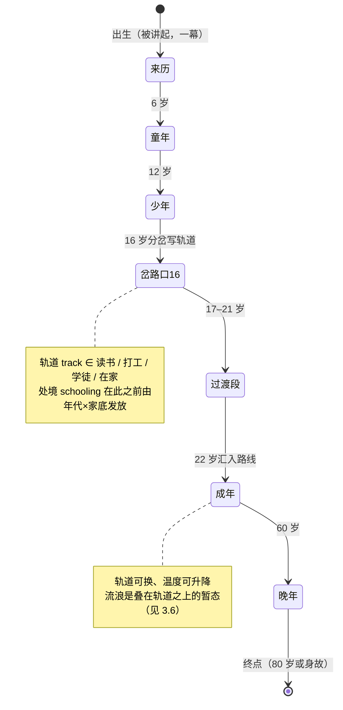

### 3.2 孩子（每个孩子一个实体）

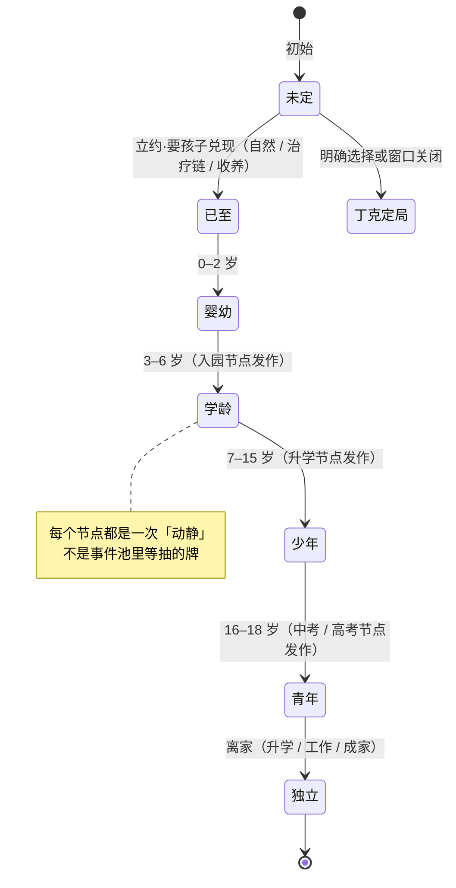

### 3.3 父母（每人一条身体进程 + 在世状态）

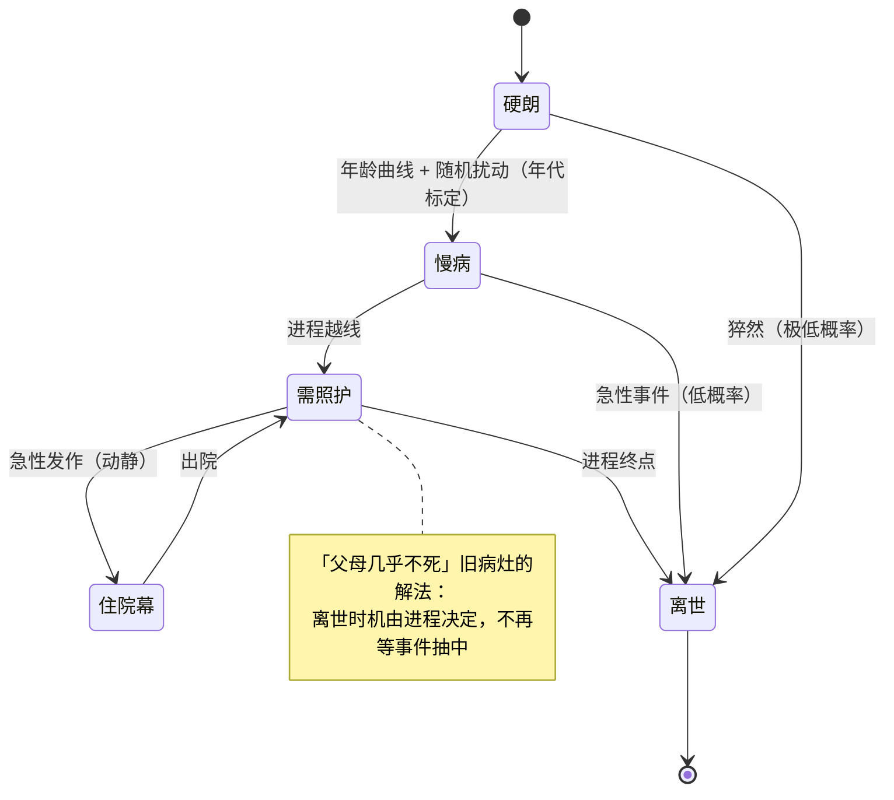

### 3.4 居所（Place：一生的落脚处是一台状态机，不是一个标签）

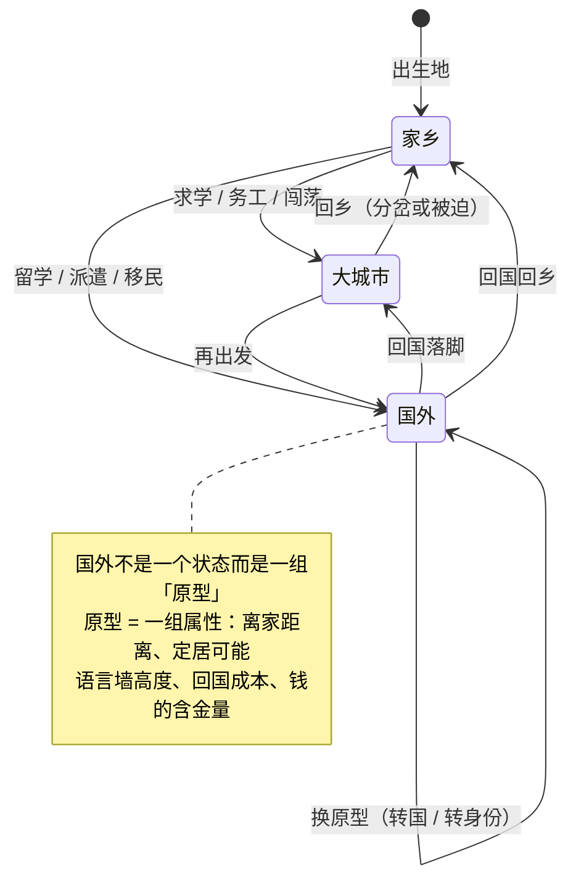

**国家原型（不写具体国名，与国内只写「大城市 / 家乡」同一语法）：**

| 原型 | 离家距离 | 定居可能 | 语言墙 | 回国成本 | 质地 |
|---|---|---|---|---|---|
| 英语圈移民国 | 远 | 高（积分/绿卡长线） | 高 | 高 | 先难后稳，扎根是主线 |
| 东亚近邻 | 近 | 中 | 中（文字近、规矩多） | 中 | 熟悉又陌生，攒钱回国常见 |
| 欧洲福利型 | 远 | 中 | 高 | 高 | 慢、高税、假多，安逸与出局并存 |
| 派遣淘金型 | 不定 | 无 | 低（封闭营地/项目制） | 低（合同结束即回） | 钱多无根，随时撤 |

事件挂**属性**不挂国名（「语言墙高」才有的事、只有「可定居」才有的事）；年代只染文字底色，不做机制。附带好处：绕开具体国家，就绕开了具体的制度与政治评价——那是本作的红线区。

### 3.5 立约（Contract：大选择从「买断价」变成「一份要过日子的约」）

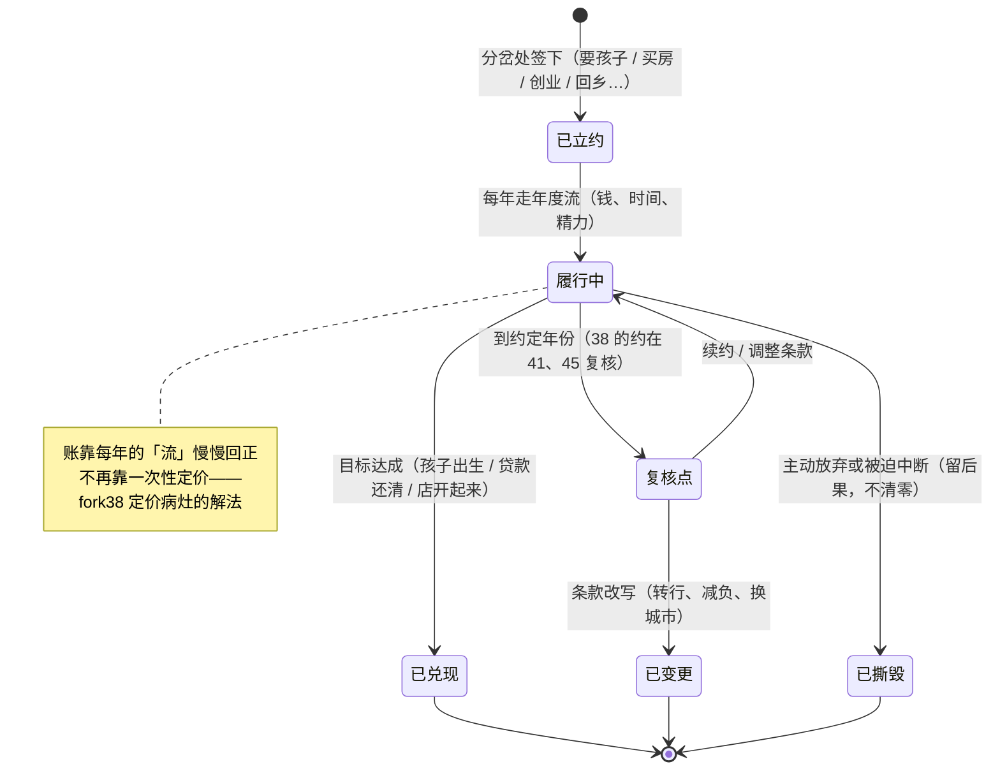

### 3.6 流浪（与轨道正交的暂态，进出都慢）

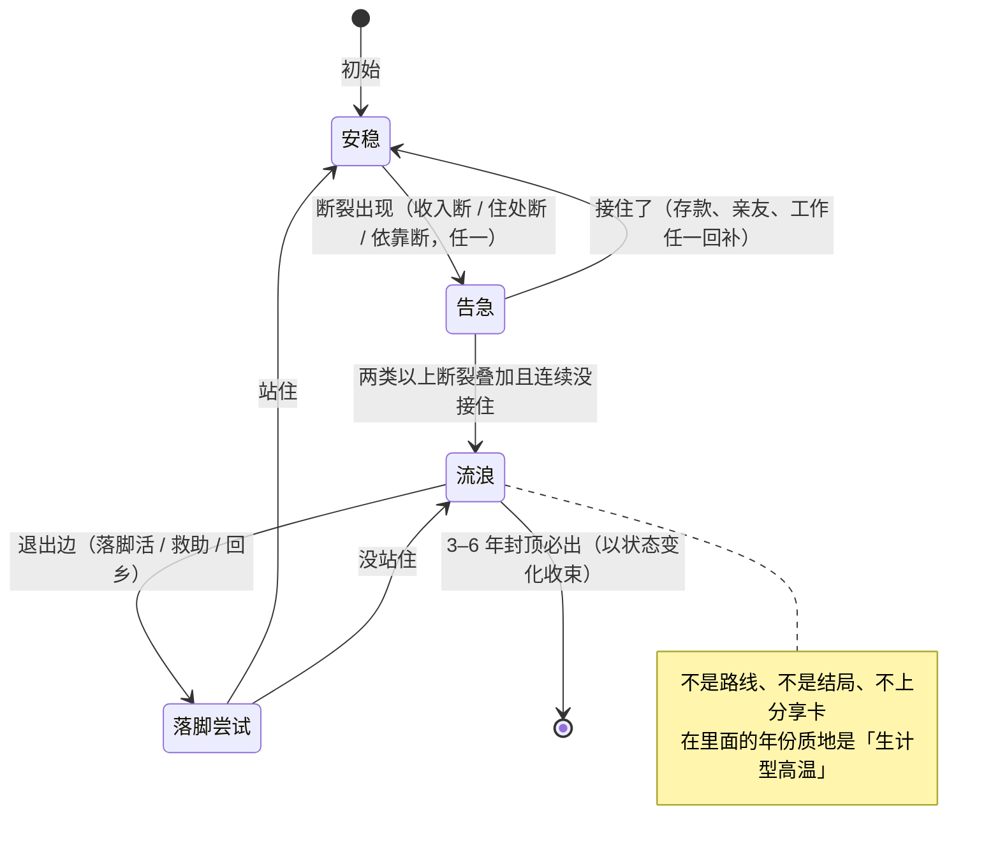

---

## 四、机会窗：分岔从「预约」变「窗口」

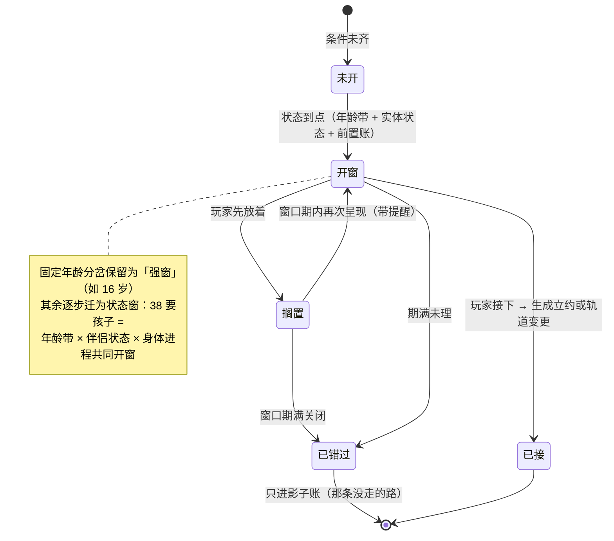

---

## 五、年度内核循环（一年的运行顺序）

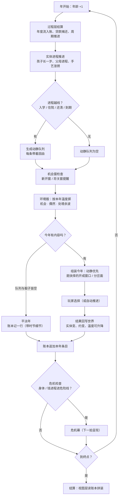

配套规则：

- **随机流分家**：世界进程、环境骰、叙事抽取各用独立随机流（由主种子派生）。往环境池里加新事件，不再改写别人的命运走向；旧种子链接的稳定性按流分别保证。
- **死亡**由身体进程与年代死亡曲线共同决定（现行三档死亡率带作为标定目标保留，不许漂移）。
- **温度**只出现在环境骰一步：决定掷几次、波动多大、平淡年多容易出现。它不碰进程、不碰死亡、不碰结局稀有度。

---

## 六、数据结构（一局游戏在内存里长什么样）

```mermaid
flowchart TD
    GS["GameState 一局的全部状态<br/>seed · kernelVer 内核版本 · stage 阶段 · age<br/>era 年代 · birthYear · temp 温度现值<br/>rhythm 节奏型 · streams 三股随机流"]
    SELF["Self 自己<br/>health 身体进程：曲线 + 现值<br/>skills 手艺进程组：涨 / 锈<br/>stats 六维：视图用，不再是唯一真相"]
    PERSON["Person 家人 ×0..n<br/>role：伴侣 / 子 / 父 / 母<br/>state：各自的状态机<br/>process：年龄、身体、学业"]
    PLACE["Place 居所 ×1<br/>kind：家乡 / 大城市 / 国家原型四种<br/>props：距离、定居、语言墙、回国成本<br/>housing：租 / 买 / 寄住 / 无"]
    WORK["Work 活计 ×1<br/>track 轨道 · form 形态<br/>雇主 / 自营 / 田地 / 无 · phase 阶段"]
    CONTRACT["Contract 立约 ×0..n<br/>kind：育儿 / 房贷 / 创业 / 照护<br/>terms 条款 · flows 年度流<br/>reviewAges 复核点 · status 状态"]
    EP["Episode 账本条目 ×0..n（只追加）<br/>age · kind：动静 / 窗口 / 环境 / 平淡 / 危机<br/>cause 因由：指向实体 / 进程 / 约<br/>choice 选择 · deltas 变化 · textRef 原文"]
    GS --> SELF
    GS --> PERSON
    GS --> PLACE
    GS --> WORK
    GS --> CONTRACT
    GS --> EP
    EP -.->|因由可指向| CONTRACT
    EP -.->|因由可指向| PERSON
    EP -.->|因由可指向| PLACE
```

读法：现在的六个状态域（伴侣、孩子、父母、宠物）就是 Person 的雏形，原样升格；flags 退场，改为「账本里查得到」——一个事实成立，当且仅当账本里有对应条目或实体状态如此。

---

## 七、温度与节奏在新内核里的位置

- 温度是**这一生的一条曲线**：轨道给起点（种田、体制内低；读书中；闯荡、出国高），立约、换轨、回乡、流浪进出都可以让它升降。存档带曲线现值，同种子可复现。
- 温度只调环境骰：掷的次数、数值波动幅度、平淡年出现概率。三者由温度一数派生，不三处各写一套。
- 节奏型是正交标记：同是低温，种田跟季节、体制内跟日历；同是高温，闯荡是机会型的密、流浪是生计型的密。节奏型决定平淡年与动静的**文案质地**，温度决定**疏密**。

## 八、视图层：结局为什么自然变多

结局空间不再靠写更多判词，而是因为账本本身变厚了：九个拼装槽位（落脚、陪伴、钱的收场、手艺、子女线、父母线、没办完的事、影子代价、认领句）各自到账本里查这一生的真实条目。两个人就算六维数值长得一样，账本不会一样——孩子几岁离的家、约在哪一年撕的、温度在哪年降下来的，都不同，拼出来的结算就不同。验收口径不变：16000 局不同组合 ≥1000、最常见 ≤2%、前 10 合计 ≤10%，第零步先测旧基线。

## 九、迁移路线（不推倒重来，分三步收）

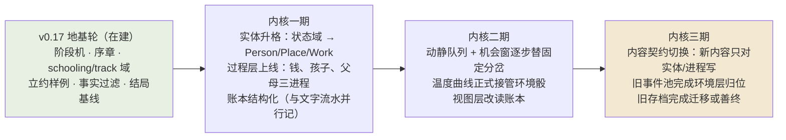

- **存档政策**：旧存档在迁移期可读完本局（老引擎路径保留到三期前）；新开局走新内核。种子语义按内核版本分段，分享链接带版本位，旧链接可复现旧局。
- **普查与校验随内核走**：每期结束重跑 16000 局护栏（死亡三档、特殊率、零命中、结局组合三数、逐路线温度派生值），不过线不进下一期。

## 十、代价与风险（先说清）

1. **内容标注要重做一遍**：2000+ 条事件从「挂旗子门」迁到「挂实体/进程语境」，是渐进的（一期先升格最常串台的职业与家庭线），但这是本方案最大的一笔工。
2. **进程要标定**：孩子、父母、钱三条进程的曲线若标错，整局的质地就错。标定靠现有年代数据与 16000 局模拟，不靠手感。
3. **平衡面变大**：进程 × 温度 × 窗口的组合比牌池大，模拟与普查的算力与用例都要扩——这是换「世界会自己走」必须付的价。
4. **回退线**：任一期护栏不过且两轮修不好，停在该期版本对外，内核退回研究状态，不许带病上线。

## 十一、质量关：完整记录审计（常设，不可跳过）

立此节的教训（2026-11-02，v0.17.0 的 16 局完整人生审计）：数字关全绿（死亡率、特殊结局率、事件命中、确定性）的一版，完整读下来仍有整类硬伤——80 岁主人公的父母 16 局中 15–16 局健在、没学过医的人拿了村医结局、1979 年出现国考报名系统。原因：统计只能查已经想到要查的东西；没想到的，永远不在表上。

常设规矩三条：

1. 每个大版本收尾，除了数字关，必须加一关完整记录审计：十几局全程跑完并完整存档（逐年流水 + 结算全文），由没看过旧报告、彼此不通气的新评审盲读，按逻辑性、故事性、真实可信性逐局打分，缺陷必须带原文引文。
2. 审计读出的模式要转成可数检查，并入常规模拟报告，不许只靠人读：本批已立三项——终局时父母存活率按年代统计；伴侣状态与事件文本的对账抽查；通用池事件的年代错位扫描。
3. 数字全绿不再算作可以交付的充分条件：交付报告必须带记录审计的结论一节，没有这一节，版本不算验收完成。

## 十二、请用户确认的点（3 个）

1. 国家原型就按四种定（英语圈移民国 / 东亚近邻 / 欧洲福利型 / 派遣淘金型），还是要增减。
2. 机会窗错过即永远错过（只进影子账），不设「后悔药」入口——确认。
3. 旧存档政策：迁移期老局用老引擎打完、新局走新内核——确认。

---

*草案完。批准后并入 docs 作内核规格，后续每轮施工对照本稿验收。*
